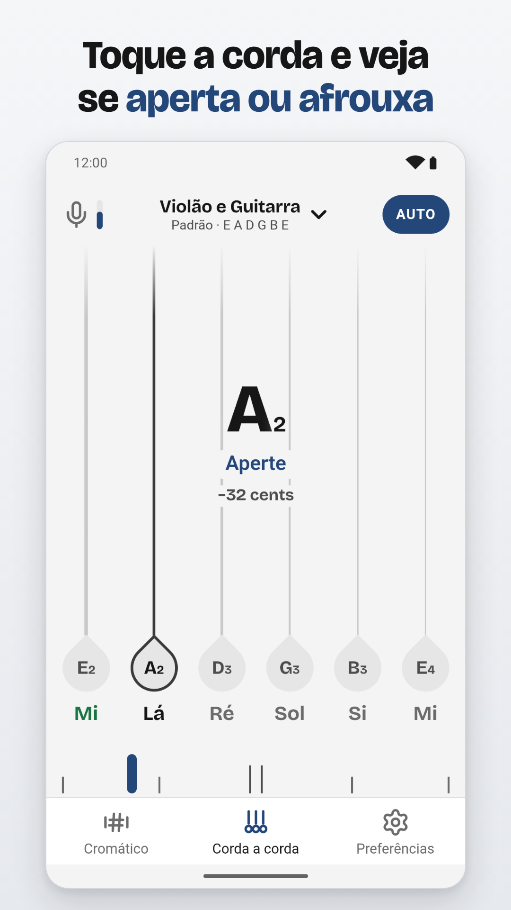
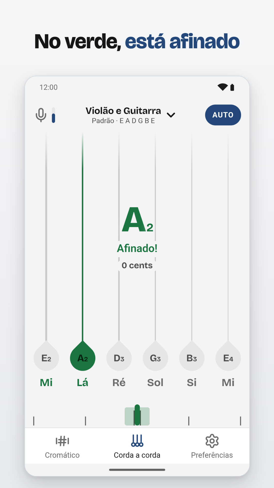
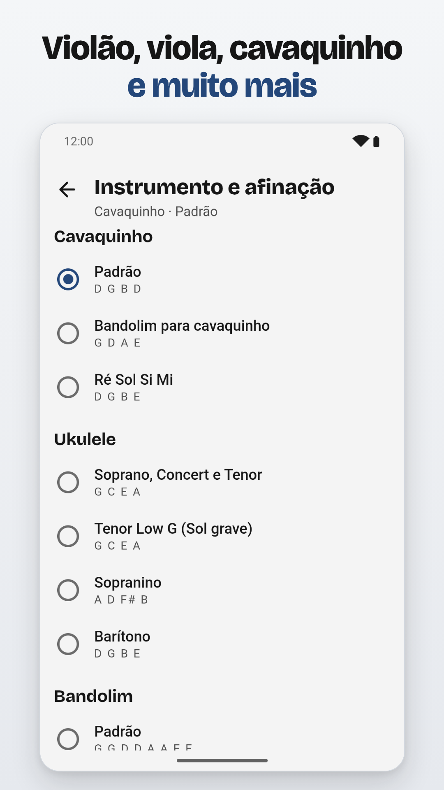
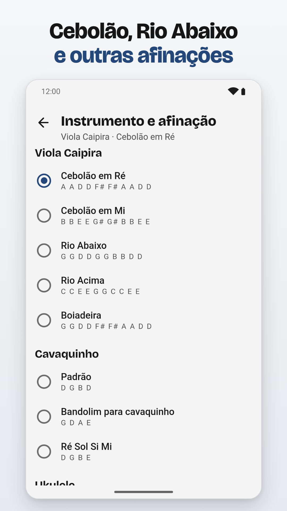
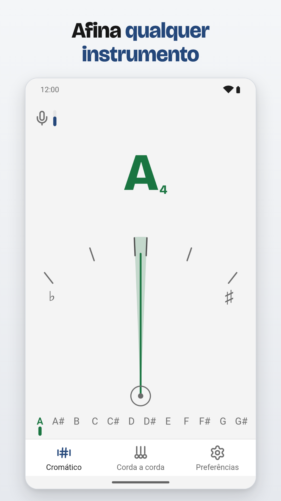
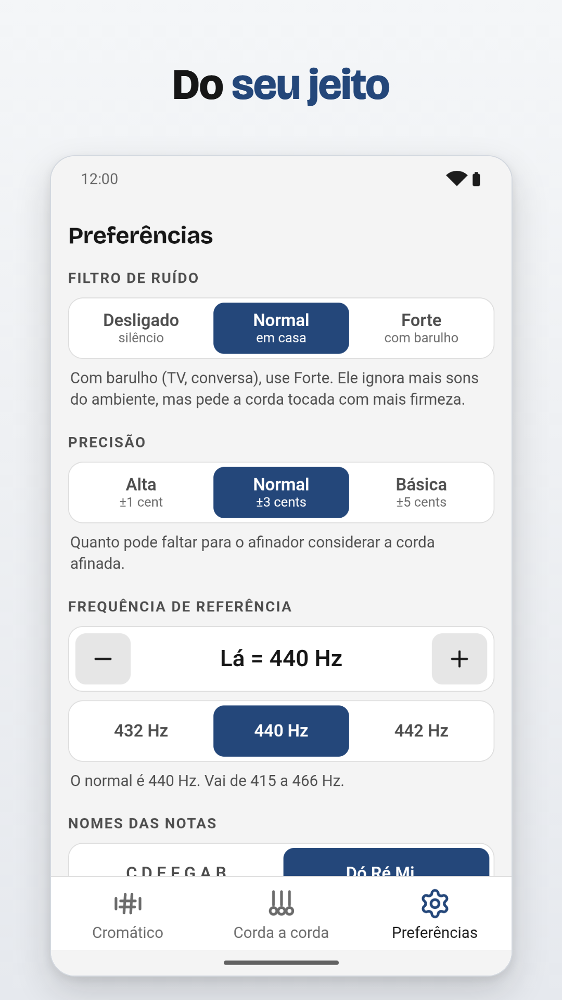

  

<h1 align="center">Afinador Nogueira</h1>

<b>Toque a corda. O Nogueira diz se aperta ou afrouxa.</b>

  Em breve na Google Play ·
  <a href="https://goklahlabs.com.br/nogueira">Página do app</a> ·
  <a href="CHANGELOG.md">Novidades</a> ·
  <a href="#english">English</a>

Afinador simples e preciso para violão, guitarra, viola caipira, cavaquinho, ukulele, bandolim, banjo, violino e viola de arco. No modo Cromático, afina qualquer instrumento de nota firme, como teclado, sopros e voz.

Gratuito, sem anúncios, sem cadastro e sem internet. O som do microfone é analisado no próprio celular e nada é gravado nem enviado.

## O que ele faz

**Corda a corda.** Escolha o instrumento e a afinação e toque uma corda. O afinador reconhece sozinho qual corda soou e mostra o que fazer: **Aperte**, **Afrouxe** ou **Afinado!** Também dá para tocar numa corda da tela e afinar só ela.

**Cromático.** Mostra a nota que está soando e um ponteiro: à esquerda, mais grave; à direita, mais agudo; no meio e em verde, afinado. Para sopros, tem transposição em Si♭, Mi♭ e Fá.

**Afinações brasileiras.** A viola caipira já vem com Cebolão em Ré e em Mi, Rio Abaixo, Rio Acima e Boiadeira. O cavaquinho tem a afinação padrão, a de bandolim e Ré Sol Si Mi. Nas cordas duplas, as duas do par afinam na mesma marcação.

**Do seu jeito.** Tema claro ou escuro, notas em Dó Ré Mi ou em letras, filtro de ruído para lugares barulhentos, precisão ajustável, Lá de referência com atalhos para 432, 440 e 442 Hz, vibração ao afinar e tela sempre acesa.

## Instrumentos e afinações

| Instrumento | Afinações |
|---|---|
| Violão e guitarra | Padrão, meio tom e um tom abaixo, Drop D, Open G, Celta (DADGAD), 7, 8 e 12 cordas e outras |
| Viola caipira | Cebolão em Ré e em Mi, Rio Abaixo, Rio Acima e Boiadeira |
| Cavaquinho | Padrão (Ré Sol Si Ré), afinação de bandolim e Ré Sol Si Mi |
| Ukulele | Soprano, Concert e Tenor, Tenor com Sol grave (Low G), Sopranino e Barítono |
| Bandolim | Sol Ré Lá Mi, em pares |
| Banjo | Padrão de 5 cordas |
| Violino | Sol Ré Lá Mi |
| Viola de arco | Dó Sol Ré Lá |
| Qualquer instrumento | No Cromático, para notas firmes |

Notas muito graves, como as do baixo e do contrabaixo, ainda não são reconhecidas.

## Telas

  
  
  

  
  
  

## Para afinar bem

1. Procure um lugar quieto. Se não der, ligue o **Filtro de ruído** nas Preferências.
2. Deixe o celular perto do instrumento, com a parte de baixo do celular, onde costuma ficar o microfone, virada para as cordas.
3. Toque uma corda de cada vez e deixe soar.
4. Afine sempre subindo: se passou do ponto, afrouxe um pouco abaixo da nota e aperte devagar até o verde.

## Privacidade

O app pede o microfone só para ouvir o instrumento. O som é analisado na hora, no próprio celular, e não é gravado nem enviado. O app não tem conta, anúncios nem rastreamento e guarda só as suas preferências. [Política de privacidade](https://goklahlabs.com.br/nogueira/privacidade/).

## Problemas e sugestões

- **Algo não funcionou?** Abra um [Problema](../../issues/new/choose), dizendo a versão do app, o modelo do celular e o instrumento.
- **Tem uma ideia?** Abra uma [Sugestão](../../issues/new/choose).
- **Dúvidas:** escreva para **support@goklahlabs.com.br**, ou use o "Fale conosco" nas Preferências do app.

---

## English

**Play a string and Afinador Nogueira tells you whether to tighten or loosen it.**

- **String by string** for guitar, the Brazilian viola caipira, cavaquinho, ukulele, mandolin, banjo, violin and viola, with the most used tunings for each. The tuner recognizes which string you played on its own.
- **Chromatic** mode for any instrument with a steady pitch, with transposition for B♭, E♭ and F instruments.
- Light or dark theme, note names in letters or in Do Re Mi, noise filter, adjustable accuracy and reference pitch.
- Free, no ads, no sign-up and no internet. The sound is analyzed on the phone and never recorded or sent. The app follows your phone's language (Portuguese or English).

Coming soon to Google Play · [App page](https://goklahlabs.com.br/nogueira) · Problems and ideas: [issues](../../issues/new/choose) · Questions: support@goklahlabs.com.br

---

  Desenvolvido por <b>GoklahLabs</b> 
  <a href="https://goklahlabs.com.br">goklahlabs.com.br</a> ·
  <a href="https://instagram.com/goklah.labs">Instagram @goklah.labs</a> ·
  <a href="mailto:hello@goklahlabs.com.br">hello@goklahlabs.com.br</a>

